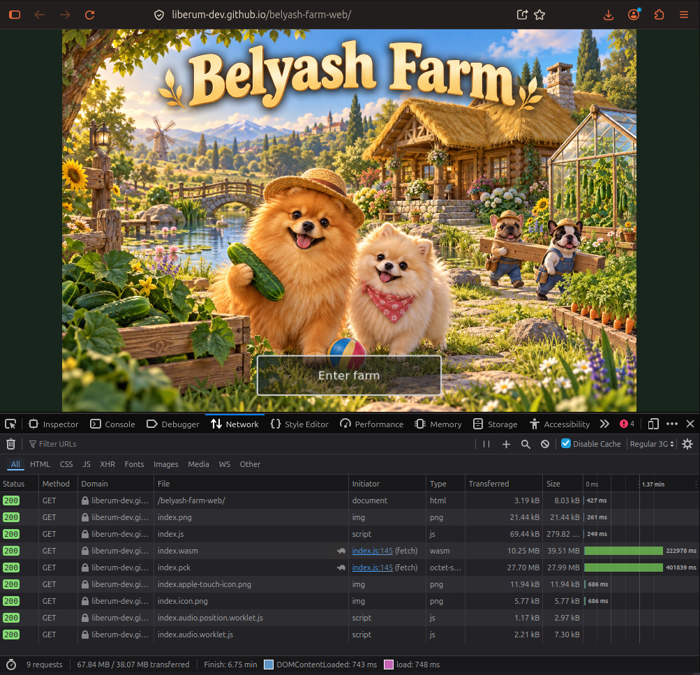

# Belyash Farm — Manual QA Portfolio

Manual QA testing portfolio based on a real browser-based game developed with Godot.

## Project Overview

**Application:** Belyash Farm
**Platform:** Web (HTML5 / WebAssembly)
**Testing Environment:** Linux Mint, Mozilla Firefox
**Test Period:** October 12–14, 2026

**Live Application:** https://liberum-dev.github.io/belyash-farm-web/

This portfolio demonstrates practical manual testing, defect reporting, negative testing, browser diagnostics and network inspection.

## Test Execution Summary

| Metric | Result |
|---|---|
| Total Tests | 5 |
| Passed | 4 |
| Failed | 1 |
| Documented Findings | 2 |

## Test Results

| ID | Test Scenario | Status |
|---|---|---|
| [TC-001](reports/TC-001.md) | Save / Load Persistence | PASS |
| [TC-002](reports/TC-002.md) | JSON Backup / Restore | PASS |
| [TC-003](reports/TC-003.md) | Invalid JSON Import | FAIL |
| [TC-004](reports/TC-004.md) | Network Loading Without Cache | PASS |
| [TC-005](reports/TC-005.md) | Slow Network Simulation (Regular 3G) | PASS |

## Documented Findings

| ID | Description | Status |
|---|---|---|
| [BUG-001](bug-reports/BUG-001.md) | BelyashSave JavaScriptBridge console error | Reproduced |
| [BUG-002](bug-reports/BUG-002.md) | Missing visible feedback on invalid JSON import | Reproduced (2/2) |

Both findings require further investigation. No saved-game data loss was observed in the executed scenarios.

## Network Testing

Browser network monitoring was performed using Firefox Developer Tools.

| Scenario | Requests | HTTP Failures | Network Finish |
|---|---|---|---|
| Cached Loading | 9 | 0 | 2.85 s |
| Cache Disabled | 9 | 0 | 7.10 s |
| Regular 3G | 9 | 0 | 6.75 min |

These figures represent individual test runs rather than statistically reliable performance benchmarks.

### Evidence — TC-005

## Tools and Technologies

- Firefox Developer Tools — Console and Network
- Git / GitHub
- Linux Mint
- JSON
- Markdown
- Godot Web / HTML5 testing

## Repository Structure

- `reports/` — test execution results and summaries
- `bug-reports/` — defect documentation
- `test-data/` — prepared test fixtures
- `evidence/` — screenshots and supporting evidence
- `test-cases/` — planned dedicated test-case documentation
- `checklists/` — planned QA checklists

## Test Reports

- [October 12 — Initial QA Test Run](reports/QA-Test-Run-2026-10-12.md)
- [October 12–14 — Consolidated QA Summary](reports/QA-Summary-2026-10-12-to-14.md)

## Planned Testing

- Cross-browser compatibility
- Responsive layout and mobile web testing
- Additional negative test scenarios
- Network failure and recovery testing
- Regression testing across application releases
- Structured test-case and checklist documentation

## Notes

This portfolio documents manual testing of a self-developed application.

Results reflect the stated environment and execution dates. This is a practical QA learning and documentation project, not an independent third-party certification.
